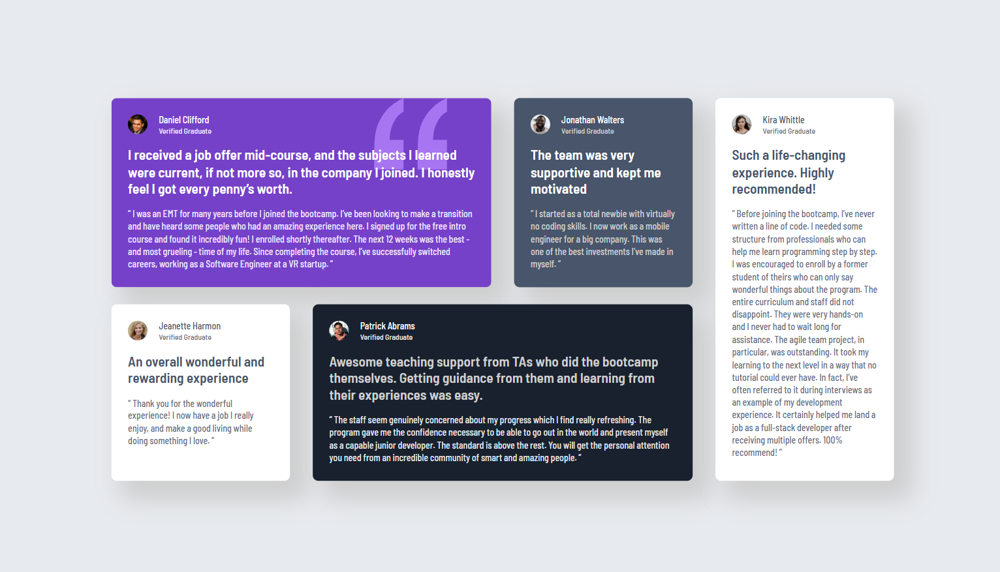

# Testimonials grid section

[Español](./README.md)

A solution to the [Testimonials grid section challenge on Frontend Mentor](https://www.frontendmentor.io/challenges/testimonials-grid-section-Nnw6J7Un7). The page presents five testimonials and adapts their layout for mobile, tablet, and desktop. It uses HTML and CSS, with no JavaScript or build tools.

## Links

- [Live site](https://jesusaid.github.io/testimonials-grid-section/)
- [Repository](https://github.com/JesuSaid/testimonials-grid-section)
- [Challenge style guide](./style-guide.md)
- Penpot: [design references](https://design.penpot.app/?screen=workspace&team-id=2f1be954-9d1b-812a-8008-e7176a4d30b3&file-id=3db45ae8-1dfd-81ce-8008-ff20166fdd41&page-id=3db45ae8-1dfd-81ce-8008-ff20166fdd42) and [style guide page](https://design.penpot.app/?screen=workspace&team-id=2f1be954-9d1b-812a-8008-ff20166fdd41&file-id=3db45ae8-1dfd-81ce-8008-ff20166fdd41&page-id=8e2c9eff-b87f-8065-8008-ff214b94b423)

## Screenshots

### Desktop

### Mobile

This screenshot shows the upper part of the mobile layout.

## Run locally

Clone the repository and open `index.html` in a browser. The fonts, portraits, and decorative SVG are included in `assets/`; there are no dependencies to install.

## Implementation

- **Semantic HTML:** `main` contains a visually hidden page-level `h1` and five `article` elements, one per testimonial. Each quote uses `blockquote`, with the author's name outside the quote. Portraits use `alt=""` because each person's name is already written beside the image.
- **BEM classes:** `testimonial` holds the shared card styles, `testimonial__...` names its parts, and `testimonial--...` modifiers distinguish individual cards.
- **Mobile-first layout:** the base layout has one column of cards up to `305px` wide, with `32px` between them. From `35rem`, CSS Grid arranges the cards in three tracks with a `5fr 2fr 5fr` ratio; Kira's quote sits beside her profile and headline. From `64rem`, four equal columns create the desktop composition; Daniel and Patrick each span two columns, while Kira spans both rows of the last column.
- **Desktop dimensions:** the grid has a `70rem` maximum width, `32px` column gaps, and `24px` row gaps. The quotation SVG is used as a decorative background on Daniel's card only on desktop.
- **Visual system:** the HSL colors from [`style-guide.md`](./style-guide.md) are defined in `:root`. Local Barlow Semi Condensed fonts at weights 500 and 600 are loaded with `@font-face` and `font-display: swap`. Cards share a radius, shadow, and internal spacing. Logical properties such as `inline-size` and `margin-inline` are used where they express the layout clearly.

## Decisions and lessons

- The challenge style guide supplies the implementation's palette. Penpot's reference sheet uses some color variants, so it was mainly used to check layout and dimensions.
- Grid changes card positions without changing the HTML reading order. On desktop, the tablet rules that still applied were inherited, and only the necessary properties were overridden.
- Setting horizontal and vertical gaps separately brought the desktop layout closer to the reference without affecting tablet.
- The work was organized into commits for markup, base styles, mobile, tablet, desktop, and final details. The [frontend practice notes](./FRONTEND-BEST-PRACTICES.md) record the criteria used during the challenge.

## Review

The layout was visually reviewed at `320px`, `375px`, `768px`, `1024px`, and `1440px`. The review covered testimonial readability, layout changes, and visible clipping in the screenshots.

## Author

Built by [JesuSaid](https://github.com/JesuSaid) from the Frontend Mentor challenge. ChatGPT assisted with reviews of the structure and styles, reasoning about breakpoints, and documenting decisions; the HTML and CSS implementation was developed throughout the challenge.
