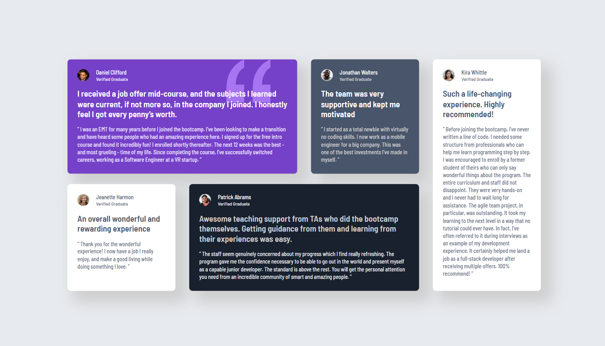
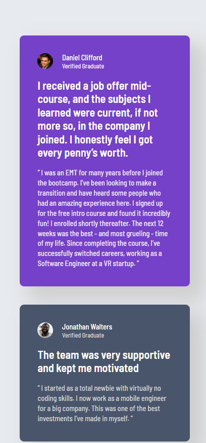

# Testimonials grid section

[English](./README-en.md)

Solución del reto [Testimonials grid section de Frontend Mentor](https://www.frontendmentor.io/challenges/testimonials-grid-section-Nnw6J7Un7). La página presenta cinco testimonios y adapta su distribución a móvil, tablet y escritorio. Está hecha con HTML y CSS, sin JavaScript ni herramientas de compilación.

## Enlaces

- [Sitio publicado](https://jesusaid.github.io/testimonials-grid-section/)
- [Repositorio](https://github.com/JesuSaid/testimonials-grid-section)
- [Guía de estilos del reto](./style-guide.md)
- Penpot: [referencias de diseño](https://design.penpot.app/?screen=workspace&team-id=2f1be954-9d1b-812a-8008-e7176a4d30b3&file-id=3db45ae8-1dfd-81ce-8008-ff20166fdd41&page-id=3db45ae8-1dfd-81ce-8008-ff20166fdd42) y [página de estilos](https://design.penpot.app/?screen=workspace&team-id=2f1be954-9d1b-812a-8008-ff20166fdd41&file-id=3db45ae8-1dfd-81ce-8008-ff20166fdd41&page-id=8e2c9eff-b87f-8065-8008-ff214b94b423)

## Capturas

### Escritorio

### Móvil

La captura muestra la parte superior de la vista móvil.

## Ver el proyecto localmente

Clona el repositorio y abre `index.html` en el navegador. Las fuentes, fotografías y el adorno SVG están incluidos en `assets/`; no hay dependencias que instalar.

## Implementación

- **HTML semántico:** `main` contiene un `h1` general visualmente oculto y cinco `article`, uno por testimonio. Cada cita usa `blockquote`; el nombre aparece fuera de la cita. Los retratos tienen `alt=""` porque el nombre de cada persona ya está escrito junto a ellos.
- **Clases BEM:** `testimonial` concentra los estilos compartidos, `testimonial__...` identifica sus partes y los modificadores `testimonial--...` distinguen las tarjetas.
- **Diseño mobile-first:** la vista base muestra una columna de tarjetas de hasta `305px`, separadas por `32px`. A partir de `35rem`, CSS Grid organiza las tarjetas en tres pistas de proporción `5fr 2fr 5fr`; la cita de Kira queda junto a su perfil y titular. A partir de `64rem`, cuatro columnas iguales forman la composición de escritorio; Daniel y Patrick ocupan dos columnas y Kira abarca las dos filas de la última.
- **Medidas de escritorio:** el conjunto tiene un ancho máximo de `70rem`, con `32px` entre columnas y `24px` entre filas. El SVG de comillas se usa como fondo decorativo de Daniel solo en escritorio.
- **Sistema visual:** los colores HSL de [`style-guide.md`](./style-guide.md) se definen en `:root`. Las fuentes locales Barlow Semi Condensed, pesos 500 y 600, se cargan con `@font-face` y `font-display: swap`. Las tarjetas comparten radio, sombra y espaciado interno. Se usan propiedades lógicas, como `inline-size` y `margin-inline`, cuando expresan mejor la intención del diseño.

## Decisiones y aprendizajes

- La guía del reto define la paleta de la implementación. La hoja de referencias de Penpot muestra algunas variantes de color, así que se usó principalmente para comprobar composición y medidas.
- Grid permite cambiar la ubicación de las tarjetas sin alterar el orden de lectura del HTML. En escritorio se conservaron las reglas de tablet que seguían siendo válidas y solo se sobrescribieron las necesarias.
- Separar el espacio horizontal del vertical permitió ajustar la composición de escritorio a la referencia sin modificar el diseño tablet.
- El trabajo se dividió en commits de estructura, estilos base, móvil, tablet, escritorio y detalles finales. [Las notas de buenas prácticas](./FRONTEND-BEST-PRACTICES.md) recogen el criterio usado durante el reto.

## Revisión

La composición se revisó visualmente a `320px`, `375px`, `768px`, `1024px` y `1440px`. Se comprobó la lectura de los testimonios, los cambios de distribución y la ausencia de recortes visibles en las capturas.

## Autoría

Proyecto de [JesuSaid](https://github.com/JesuSaid), a partir del reto de Frontend Mentor. ChatGPT se utilizó como apoyo para revisar la estructura y los estilos, razonar sobre los breakpoints y documentar las decisiones; la implementación HTML y CSS se desarrolló durante el reto.
